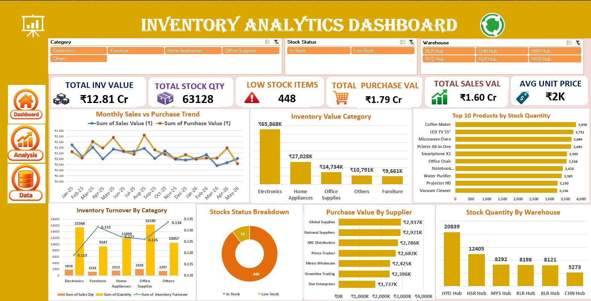
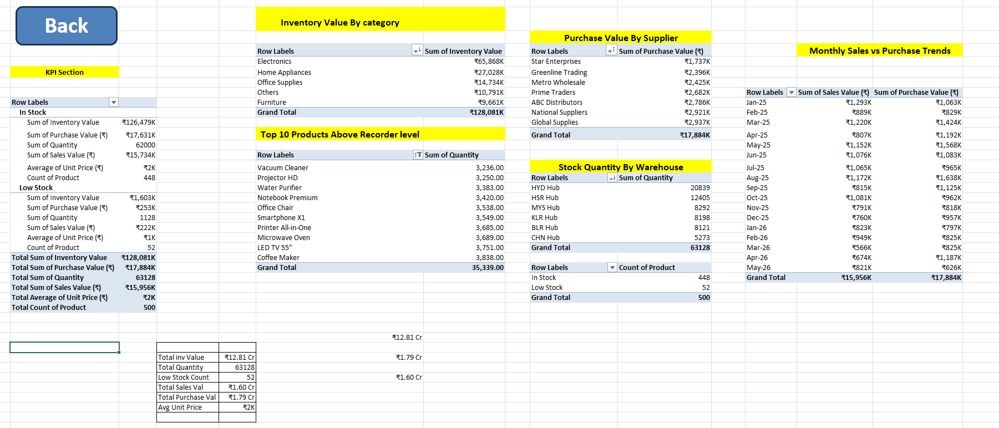

# 📊 Inventory Analytics Dashboard

**Interactive Inventory Analytics Dashboard using Microsoft Excel**

## 📌 Project Overview

This project focuses on analyzing inventory data using Microsoft Excel. It provides insights into inventory performance, stock availability, product categories, warehouse distribution, supplier purchases, and monthly sales trends.

The objective is to transform raw inventory data into meaningful business insights and support better inventory management decisions.

## 🎯 Project Objectives

- Analyze overall inventory performance.
- Monitor stock availability and low-stock products.
- Identify top products by quantity.
- Analyze inventory value across different categories.
- Compare warehouse-wise stock quantities.
- Evaluate monthly sales and purchase trends.
- Analyze supplier-wise purchase values.

## 🛠️ Tools & Technologies

- Microsoft Excel
- Pivot Tables
- Pivot Charts
- Slicers
- Data Analysis

## 📂 Project Files

- **Excel Workbook:** Inventory Analytics Dashboard.xlsx
- **Dashboard Screenshot:** dashboard-screenshot.jpg
- **Pivot Tables Screenshot:** pivot-tables.png

## 📂 Dataset Information

- Total Records: 500
- Total Inventory Quantity: 63,128
- Total Inventory Value: ₹12.81 Crore
- Data Period: January 2025 – May 2026

## 📊 Analysis Performed

1. Inventory Value by Category
2. Top 10 Products by Quantity
3. Purchase Value by Supplier
4. Stock Quantity by Warehouse
5. Monthly Sales vs Purchase Trends
6. Stock Status Analysis

## 📈 Dashboard Preview

## 📋 Pivot Table Analysis
Pivot Tables were used to summarize and analyze inventory data across different categories, products, warehouses, suppliers, and monthly trends.

## 💡 Key Business Insights
## 💡 Final Key Insights

1. **Inventory value is concentrated in Electronics (51.4%).** Laptop Pro 15 alone holds 19.9% of total value but has the lowest sell-through (9.0%), so it is an overstock risk.
2. **Sales are declining while stock keeps building.** Sales fell ~28% (Jan–Apr 2026 vs Jan–Apr 2025), but purchases fell only ~19%.
3. **Total purchases (₹1.79 Cr) exceed total sales (₹1.60 Cr) by ~12%.**
4. **HYD Hub holds 35.8% of inventory value** (20,839 units), which creates a concentration risk.
5. **Low stock is a small problem in value terms.** 52 of 500 records (10.4%) are Low Stock, but they represent only 1.25% of inventory value.
6. **Low-stock rates differ by location and category.** KLR (14.9%) and CHN (14.6%) are the worst warehouses; Furniture (16.4%) is the worst category.
7. **Peaks:** January 2025 had the highest sales; August 2025 had the highest purchases.

## ✅ Recommendations

1. **Cut purchase orders for slow-moving, high-value items** (Laptop Pro 15, LED TV 55") until sell-through improves.
2. **Align purchasing with sales.** Purchases should follow the declining sales trend to stop stock build-up.
3. **Rebalance stock from HYD Hub to KLR and CHN** to reduce concentration and fix their low-stock rates.
4. **Prioritise reorders for Furniture**, which has the highest low-stock rate.
5. **Track sell-through % (Sales Qty ÷ Quantity) as a KPI** and review it monthly, so overstock is caught early.

> Note: May 2026 data is available only up to 15 May. Quantity is a sum of dated records, not a single-day stock count.

## 📌 Conclusion

This project demonstrates how Microsoft Excel can be used to analyze inventory data, create interactive dashboards, identify business trends, and generate meaningful insights for better inventory management.

## 👨‍💻 Author

**Lucky Kumar**

Aspiring Data Analyst

**Skills:** Excel | SQL | Python | Power BI
